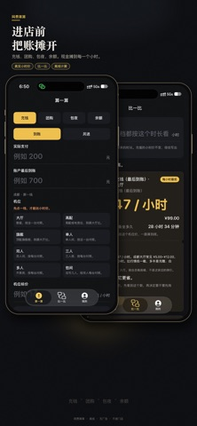
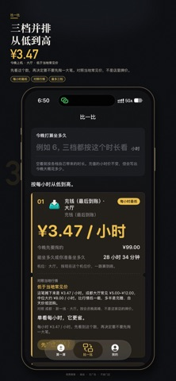
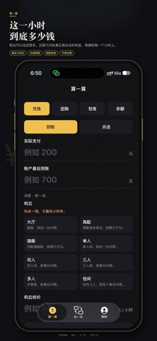

  
  <h1>网费算算</h1>
  
<strong>进店前，先算清这一小时要花多少钱。</strong>

  
把网吧的充值赠送、团购小时包和包夜换算成每小时花费，再选适合自己的套餐。

  
<a href="https://apps.apple.com/cn/app/%E7%BD%91%E8%B4%B9%E7%AE%97%E7%AE%97/id6812977644"><strong>在 App Store 免费下载</strong></a> · iPhone · iOS 26 或更新版本

## 应用预览

  
  &nbsp;
  
  &nbsp;
  

## 可以做什么

- **算清充值赠送**　区分实付金额、最终到账和另外赠送，再结合门店时价估算每小时成本。
- **比较套餐**　按实际使用时长把团购小时包和包夜换算成每小时花费，最多并排比较三个方案。
- **估算余额**　填入当前余额和门店计费信息，估算还能上网多久。
- **保存常用套餐**　记下常去的店和套餐方便下次查阅。无需注册，账本默认保存在这台 iPhone 上。

## 了解更多

[产品官网](https://zskj.top/products/internet-fees.html) · [使用支持](https://wb.zskj.top/support.html) · [隐私说明](https://wb.zskj.top/privacy.html)
